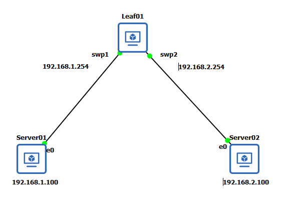

# ACL

在 NVIDIA (Cumulus Linux) 生態系中，存取控制串列（ACL）是管理流量、保護控制層與提升效能的核心元件。以下將從架構、與 iptables 的關係、使用方式與資料流、狀態機制，以及使用限制來為你全面解析。

## ACL 的架構原理

在 Cumulus Linux 中，ACL 主要用於在 OSI 模型的第 2、3 和 4 層對封包進行分類與過濾。它的架構基於 Linux 核心的過濾機制。下圖顯示了封包從進入到輸出的流程：*Prerouting -> 路由決定 -> (Input -> 控制平面軟體 -> Output) / Forward -> Postrouting*


* **Chains (鏈)：** 決定封包在系統生命週期中被檢驗的時間點。
  * PREROUTING：在交換器對封包進行路由之前接觸封包。
  * INPUT：在交換器確定封包是發往本機系統之後，但在控制平面軟體接收它們之前接觸封包。
  * FORWARD：在傳輸流量通過交換器移動時接觸它。
  * OUTPUT：在來自控制平面軟體的封包離開交換器之前接觸它們。
  * POSTROUTING：在封包離開交換器之前（但在做出路由決定之後）立即接觸封包。
* **Tables (表)**
  * Filter：對流量進行分類或過濾流量。
  * NAT：套用網路位址轉換 (Network Address Translation) 規則。
  * Mangle：在封包通過交換器時更改封包。
* **Rules（規則）** 規則將想要控制的流量進行分類。將規則套用於鏈，而鏈則附加到表上。下圖顯示指令範例解析，`-t mangle (Table) -A PREROUTING (Chain) -p tcp --dport 22 (Matches) -j (Jump) DSCP --set-dscp 46 (Targets)`
  * Table：第一個參數是表 (table)。
  * Chain：第二個參數是鏈 (chain)。每個表支援幾個不同的鏈。
  * Matches (比對條件)：第三個參數是比對條件 (match)。可以在單一規則中指定多個比對條件。然而，在規則中使用的比對條件越多，該規則消耗的記憶體就越多。
  * Jump (跳轉)：Jump 指定了規則的目標；即如果封包符合該規則，要採取什麼動作。如果在規則中省略此選項，符合該規則不會對封包產生任何影響，但規則上的計數器會增加。
  * Targets (目標)：Target 是一個使用者定義的鏈（不同於此規則所在的鏈）、一個立即決定封包命運的特殊內建目標（例如 DROP），或者是一個擴展目標。


每個表都有一組預設鏈，這些鏈在通過交換器的路徑的不同點修改或檢查封包。鏈包含影響流量的個別規則。在架構上，Cumulus 5.0 以後的版本，將硬體轉發（Transit）的 Ingress（入站）ACL 規則放在 `-t mangle -A PREROUTING` 鏈中，而 Egress（出站）ACL 則放在 `-t mangle -A POSTROUTING` 鏈中。

## 與底層 Iptables 的關係

Cumulus Linux 是基於 Linux 的作業系統，其 ACL 語法完全相容於 Linux 的使用者空間工具：`iptables` (IPv4)、`ip6tables` (IPv6) 和 `ebtables` (Layer 2 MAC)。

絕對**不要**直接使用 `iptables` 指令來設定資料層（Data Plane）的轉發規則。如果直接下達 `iptables -A INPUT ...`，該規則只會存在於 Linux Kernel 中，**無法被硬體加速 (Hardware Accelerated)**，交換器的 ASIC 晶片不會生效。

在 NVIDIA 交換器上，必須透過 NVUE 或 `cl-acltool` 進行配置。這些工具會將規則寫入 `/etc/cumulus/acl/policy.d/` 等目錄中，並透過 `switchd` 這個硬體抽象層守護行程 (Daemon)，將 Linux Kernel 的設定同步燒錄到 Spectrum ASIC 底層的 TCAM / ATCAM 記憶體中，藉此實現線速 (Wire-speed) 轉發。如果執行 `cl-acltool -i` 進行重載，系統會清空所有不在 policy 設定檔內的 `iptables` 規則。

## Stateful 與 Stateless 狀態是什麼？

在防火牆與 ACL 的概念中

* **Stateful (有狀態)：** 交換器會記住連線的狀態（例如 TCP 的三方交握），並允許同一條連線的回應封包通過（例如 `ESTABLISHED`, `RELATED` 狀態）。
* **Stateless (無狀態)：** 設備不記錄連線狀態，單純依據每一個獨立的封包標頭（IP、Port、TCP Flag）來決定允許或丟棄。

在 Cumulus Linux 的支援情況

* **Data Plane (資料層/硬體轉發) 是 Stateless 的：** 寫入硬體 ASIC 的過濾規則（Transit 流量）不支援連線狀態比對（connection-state），你必須手動透過特定的 TCP Flags（如 SYN, ACK）進行無狀態的過濾。
* **Control Plane (控制層防火牆) 支援 Stateful：** 保護交換器 CPU 本身的防火牆規則（如 SSH 或 BGP 的防護），是在作業系統層級處理。因此可以支援 `match ip connection-state new` 或 `established` 這種 Stateful 的比對機制。

下圖可以看到 1 和 2 貫穿交換器屬於資料平面；3 和 4 屬於控制平面。


## ACL 有什麼限制？

在使用 Cumulus Linux 的 ACL 時，請注意以下架構限制：

1. **硬體資源容量限制 (TCAM/ATCAM)：** 交換器的規則數量受限於硬體記憶體資源。如果網路中包含超過 1000 個 VLAN 介面，VLAN flow counters 等功能會與 ACL 共用記憶體空間（如 Spectrum-2 以上的 ATCAM），可能會導致 `No More Resources` 的硬體寫入錯誤。
2. **Atomic 與 Non-atomic 更新模式：** 預設為 Atomic 模式，會保留 50% 的硬體空間以實現*無中斷規則替換*。若為了佈署更多的規則可切換為 Non-atomic 模式，但更新大規模規則時可能造成短暫的流量中斷。
3. **不支援的規則與比對機制：** 並非所有 Linux `iptables` 功能都能寫入硬體。例如：不支援 Inverse matching (反向比對，如 `! -p tcp`)、不支援基於 UID 的 `LOG` 功能，以及部分 Extended targets。
4. **介面套用限制：**
    * Egress (出站) ACL 無法針對邏輯的 `bond` (Port-channel) 介面進行比對，你只能把規則套用到組成 Bond 的實體成員介面上。
    * ACL 的輸出埠若設定為子介面 (Subinterface, 例如 `swp49s1.100`) 將無法成功比對，只能套用於主要實體埠。

## Lab

Cumulus NVUE 5.16。下圖是本實驗的環境一台交換器和兩台 Server，主要目的是了解交換器 ACL 的資料平面和控制平面設定以及原理。



數據平面和控制平面 ACL 定義，透過以下表格呈現

|流量類型|處理位置|iptables 鏈|說明|
|---|---|---|---|
|數據平面 (Transit)|硬體 (ASIC)|FORWARD|穿越交換器的流量，以範例來說是 Server01 存取 Server02。|
|控制平面 (Local)|軟體 (CPU)|INPUT|目的地為交換器本身的流量，以範例來說是 Server01 SSH 進入 Leaf01。|

當執行 `nv config apply` 之後，定義的 NVUE YAML 內容系統會將高階抽象配置轉換為底層 Linux 核心的 `iptables` 規則，接著再透過底層的 `switchd` 行程，將這些規則寫至 Spectrum ASIC 的硬體記憶體中，以實現線速轉發與阻擋。

要確認這些寫入規則是否已經成功載入到 Linux 核心的記憶體中，使用 Cumulus 專屬的 `cl-acltool`，它能確保看到的是與硬體加速同步的規則。執行 `cl-acltool -L ip` 指令來檢視 IPv4 的規則。

如果在套用配置後發現規則沒有生效，可以檢查 `/var/log/syslog` 或 `/var/log/switchd.log`。如果底層的 TCAM / ATCAM 硬體資源已經耗盡，會在日誌中看到 `error: hw sync failed (sync_acl hardware installation failed)` 或是 `No More Resources` 之類的硬體寫入錯誤。

### Leaf01

```yaml
- set:
    system:
      hostname: leaf01

    interface:
      swp1:
        vrf: blue
        ipv4:
          address:
            192.168.1.254/24: {}
      swp2:
        vrf: red
        ipv4:
          address:
            192.168.2.254/24: {}

    vrf:
      blue:
        router:
          static:
            192.168.2.0/24:
              via:
                swp2: {}
      red:
        router:
          static:
            192.168.1.0/24:
              via:
                swp1: {}

```

應用至底層

```bash
cumulus@cumulus:mgmt:~$ nv config patch nvue.yaml
created [rev_id: 3]
cumulus@cumulus:mgmt:~$ nv config apply
```

### Server

##### Server01

```yaml
network:
  version: 2
  ethernets:
    enp2s0:
      match:
        macaddress: "0c:48:5a:2b:00:00"
      dhcp4: false
      dhcp6: false
      set-name: "enp2s0"
      addresses:
        - 192.168.1.100/24
      routes:
        - to: default
          via: 192.168.1.254
```

##### Server02

```yaml
network:
  version: 2
  ethernets:
    enp2s0:
      match:
        macaddress: "0c:74:2f:2a:00:00"
      dhcp4: false
      dhcp6: false
      set-name: "enp2s0"
      addresses:
        - 192.168.2.100/24
      routes:
        - to: default
          via: 192.168.2.254
```

### Data Plan Example

配置完後，透過 server01 到 server02 或是反向都是可以通訊。其資料流會貫穿交換器至另外的 Server，因此屬於資料平面的設定。

```bash
~$ ping 192.168.2.100 -c 2
PING 192.168.2.100 (192.168.2.100) 56(84) bytes of data.
64 bytes from 192.168.2.100: icmp_seq=1 ttl=63 time=1.07 ms
64 bytes from 192.168.2.100: icmp_seq=2 ttl=63 time=0.796 ms

--- 192.168.2.100 ping statistics ---
2 packets transmitted, 2 received, 0% packet loss, time 1002ms
rtt min/avg/max/mdev = 0.796/0.931/1.067/0.135 ms

```

我們透過新增一條 ACL，來讓 server01 和 server02 無法互相存取 。leaf01 新增下面配置

```yaml
- set:
    acl:
      BLOCK_PING:
        type: ipv4
        rule:
          '10':
             action:
               deny: {}
             match:
               ip:
                 protocol: icmp
                 source-ip: 192.168.1.0/24
                 dest-ip: 192.168.2.0/24
    interface:
      swp1:
        acl:
          BLOCK_PING:
            inbound: {}
```

配置完成後 server01 無法連到 server02。反之。

```bash
$ ping 192.168.2.100 -c 2
PING 192.168.2.100 (192.168.2.100) 56(84) bytes of data.
```

對於 NVUE 建立的 ACL，預設會存放在 `/etc/cumulus/acl/policy.d/50_nvue.rules`。

```bash
$ sudo cat /etc/cumulus/acl/policy.d/50_nvue.rules
# Auto-generated by NVUE!
# Any local modifications will prevent NVUE from re-generating this file.
# md5sum: cd9bd588dc5d6149c71c07985d50603c


[iptables]


## ACL BLOCK_PING in dir inbound on interface swp1 ##
# rule-id #10:  #
-t mangle -A PREROUTING -i swp1 -m comment --comment rule_id:10,acl_name:BLOCK_PING,dir:inbound,interface_id:swp1 -s 192.168.1.0/24 -d 192.168.2.0/24 -p icmp -j DROP

[ip6tables]


[ebtables]
```

從內容來看，因將規則套用於 swp1 的 inbound (入站方向)，在 Cumulus 5.0 之後的版本，這會被翻譯成套用於 `mangle` 表的 `PREROUTING` 鏈。這代表封包從 swp1 進入且在進行路由判斷之前（PREROUTING），只要符合 ICMP 協定以及指定的來源與目的網段，就會被丟棄 (DROP)。

執行 `cl-acltool -L ip` 指令來檢視 IPv4 的規則。在輸出的 `TABLE mangle` 將會看到剛才那條阻擋 ICMP 互 Ping 的規則已經在系統中生效。

```bash
$ sudo cl-acltool -L ip
warning: Detected platform is Cumulus VX
warning: Running in no-hw-sync mode. No rules will be programmed in hw
-------------------------------
Listing rules of type iptables:
-------------------------------
TABLE filter :
Chain INPUT (policy ACCEPT 0 packets, 0 bytes)
 pkts bytes target     prot opt in     out     source               destination
    0     0 DROP       all  --  swp+   any     240.0.0.0/5          anywhere
    0     0 DROP       all  --  swp+   any     loopback/8           anywhere
    0     0 DROP       all  --  swp+   any     224.0.0.0/4          anywhere
    0     0 DROP       all  --  swp+   any     255.255.255.255      anywhere
 7783  513K ACCEPT     all  --  any    any     loopback/8           loopback/8
    7  2296 ACCEPT     all  --  lo     any     anywhere             anywhere
    0     0 DROP       all  --  !lo    any     anywhere             loopback/8
    0     0 DROP       icmp --  any    any     anywhere             anywhere             icmp timestamp-request
    0     0 ACCEPT     all  --  any    any     anywhere             anywhere             /* rule_id:30,acl_name:acl-default-dos,dir:inbound,interface_id:control-plane */ ctstate RELATED,ESTABLISHED
    0     0 DROP       tcp  --  any    any     anywhere             anywhere             /* rule_id:40,acl_name:acl-default-dos,dir:inbound,interface_id:control-plane */ tcp flags:FIN,SYN,RST,ACK/ACK ctstate NEW
    0     0 DROP       all  -f  any    any     anywhere             anywhere             /* rule_id:50,
    ...
TABLE mangle :
Chain PREROUTING (policy ACCEPT 7849 packets, 543K bytes)
 pkts bytes target     prot opt in     out     source               destination
    4   336 DROP       icmp --  swp1   any     192.168.1.0/24       192.168.2.0/24       /* rule_id:10,acl_name:BLOCK_PING,dir:inbound,interface_id:swp1 */

Chain INPUT (policy ACCEPT 7811 packets, 535K bytes)
 pkts bytes target     prot opt in     out     source               destination

Chain FORWARD (policy ACCEPT 10 packets, 840 bytes)
 pkts bytes target     prot opt in     out     source               destination

Chain OUTPUT (policy ACCEPT 7734 packets, 510K bytes)
 pkts bytes target     prot opt in     out     source               destination

Chain POSTROUTING (policy ACCEPT 7744 packets, 511K bytes)
 pkts bytes target     prot opt in     out     source               destination


TABLE raw :
Chain PREROUTING (policy ACCEPT 8001 packets, 553K bytes)
 pkts bytes target     prot opt in     out     source               destination

Chain OUTPUT (policy ACCEPT 7882 packets, 520K bytes)
 pkts bytes target     prot opt in     out     source               destination
    0     0 CT         udp  --  any    any     anywhere             anywhere             udp dpt:tftp CT helper tftp


TABLE nat :
Chain PREROUTING (policy ACCEPT 1 packets, 84 bytes)
 pkts bytes target     prot opt in     out     source               destination

Chain INPUT (policy ACCEPT 34 packets, 2332 bytes)
 pkts bytes target     prot opt in     out     source               destination

Chain OUTPUT (policy ACCEPT 211 packets, 12952 bytes)
 pkts bytes target     prot opt in     out     source               destination

Chain POSTROUTING (policy ACCEPT 178 packets, 10704 bytes)
 pkts bytes target     prot opt in     out     source               destination

```

### Control Plan Example

場景上，可以應用在交換器本身服務的存取控管。這邊範例呈現是，僅允許特定管理主機 SSH 進入 Leaf01，其餘全部拒絕。以下配置顯示我們的範例不允許 Server02 遠端 Leaf01 交換器。

```yaml
- set:
    acl:
      BLOCK_SSH:
        type: ipv4
        rule:
          '10':
             action:
               deny: {}
             match:
               ip:
                 protocol: tcp
                 tcp:
                   dest-port:
                     '22': {}
                 source-ip: 192.168.2.0/24
    system:
      control-plane:
        acl:
          BLOCK_SSH:
            inbound: {}

```

欄位定義:

* `acl: BLOCK_SSH`: 宣告建立一個名為 `BLOCK_SSH` 的存取控制串列 (ACL)。這是一個容器，用來群組化與管理內部的多筆規則。
* `type: ipv4`: 指定這個 ACL 的協定類型為 IPv4，這決定了它底層會被轉換為 `iptables` 規則（若為 IPv6 則是 ip6tables，MAC 則是 ebtables）。
* `rule: '10'`: 定義規則的序號 (Sequence ID)。ACL 的運作邏輯是由上而下依序比對 (Sequential Match)，封包一旦配對到最先符合的規則，就會執行動作並結束後續比對。設定為 `10` 是一種 Best Practice，方便未來若有需要，可在其前後安插新規則（如 rule 5 或 rule 20）。
* `action: deny`: 指定當封包符合底下的條件時的處置動作。deny 代表拒絕，封包會被直接丟棄 (對應底層的 DROP)。
* `match: ip`: 開始定義 IP 封包的特徵比對條件。
* `protocol: tcp`: 指定只比對傳輸層協定為 TCP 的封包。
* `tcp: dest-port: '22'`: 進一步指定 TCP 的目的埠號 (Destination Port) 必須是 22 (即 SSH 服務)。
* `source-ip: 192.168.2.0/24`: 指定封包的來源 IP 網段必須是` 192.168.2.0/24`。

接著執行遠端，其結果是被拒絕的。

```bash
$ ssh cumulus@192.168.2.254


```

再透過 NVUE 檢視控制層統計資訊，只要你看到 Rule 10 的 In Packet (入站命中封包數) 與 In Byte (入站命中位元組數) 在你嘗試 SSH 登入時有持續增加，這就代表封包已經成功被這條 ACL 規則匹配並丟棄。

```bash
$  nv show system control-plane acl BLOCK_SSH statistics
Rule  In Packet   In Byte          Out Packet  Out Byte         Action                                        Match
----  ----------  ---------------  ----------  ---------------  --------------------------------------------  ----------------------------
10    13          780 Bytes                                     deny                                          ip
                                                                                                                   protocol          : tcp
                                                                                                                   source-ip         : 192.168.2.0/24
                                                                                                                   tcp
                                                                                                                     dest-port       : 22

```

另外可透過底層 `cl-acltool` 檢視 `iptables`，`pkts` 和 `bytes` 欄位代表命中此規則的封包數量與大小。當從 Server02 不斷嘗試 SSH 時，這個數字會隨之遞增。`target DROP` 代表動作為拒絕。後方的註解 `/* rule_id:10,acl_name:BLOCK_SSH... */` 則清楚標示這條底層 iptables 規則是由 NVUE 的 BLOCK_SSH 所生成的。定義的這條規則會被安插進 `INPUT` 鏈 (送往交換器本機 CPU 處理前的過濾階段)。

```bash
$ sudo cl-acltool -L ip
[sudo] password for cumulus:
warning: Detected platform is Cumulus VX
warning: Running in no-hw-sync mode. No rules will be programmed in hw
-------------------------------
Listing rules of type iptables:
-------------------------------
TABLE filter :
Chain INPUT (policy ACCEPT 0 packets, 0 bytes)
 pkts bytes target     prot opt in     out     source               destination
 ...
    0     0 DROP       tcp  --  any    any     anywhere             anywhere             /* rule_id:80,acl_name:acl-default-dos,dir:inbound,interface_id:control-plane */ ctstate INVALID
    0     0 DROP       tcp  --  any    any     anywhere             anywhere             /* rule_id:90,acl_name:acl-default-dos,dir:inbound,interface_id:control-plane */ tcpmss match !536:65535 ctstate NEW
   14   840            tcp  --  any    any     anywhere             anywhere             /* rule_id:100,acl_name:acl-default-dos,dir:inbound,interface_id:control-plane */ tcp dpt:ssh ctstate NEW recent: SET name: acl_test side: source mask: 255.255.255.255
    0     0 DROP       tcp  --  any    any     anywhere             anywhere             /* rule_id:110,acl_name:acl-default-dos,dir:inbound,interface_id:control-plane */ tcp dpt:ssh ctstate NEW recent: UPDATE seconds: 60 hit_count: 100 name: acl_test side: source mask: 255.255.255.255
    0     0 DROP       tcp  --  any    any     anywhere             anywhere             /* rule_id:120,acl_name:acl-default-dos,dir:inbound,interface_id:control-plane */ tcp flags:RST/RST limit: above 5/min burst 2 mode srcip htable-expire 30000
    0     0 DROP       tcp  --  any    any     anywhere             anywhere             /* rule_id:130,acl_name:acl-default-dos,dir:inbound,interface_id:control-plane */ ctstate NEW limit: above 50/sec burst 30 mode srcip htable-expire 30000
   13   780 DROP       tcp  --  any    any     192.168.2.0/24       anywhere             /* rule_id:10,acl_name:BLOCK_SSH,dir:inbound,interface_id:control-plane */ tcp dpt:ssh
...
```

### 驗證

1. 檢查 ASIC 硬體寫入狀態與命中統計 (Data Plane)
    可以使用以下 NVUE 指令來監看該介面上的 ACL 命中統計

    ```bash
    $ nv show interface swp1 acl BLOCK_PING statistics 10
                operational     applied
    -------------  --------------  -------
    match
    ip
        source-ip  192.168.1.0/24
        dest-ip    192.168.2.0/24
        protocol   icmp
    action         deny
    inbound
    packet       4
    byte         336 Bytes
    ```

    如果在 Server01 嘗試 Ping Server02 時，你看到此指令輸出中的 In Packet (入站命中封包數) 與 In Byte (入站命中位元組數) 不斷增加，那就代表硬體層級已經成功攔截並丟棄了這些流量。

2. 檢查寫入狀態與命中統計 (Control Plane)

    ```bash
    $  nv show system control-plane acl BLOCK_SSH statistics
    ```
